# 🐍 Python Programming Lab: Reusable Functions, Algorithmic Logic & Enterprise Business Systems (Task 04)

<div align="center">

[](https://colab.research.google.com/github/islamyasser424-design/Python-Task-04/blob/main/Python_Task_04.ipynb)
[](https://www.python.org/)
[](https://jupyter.org/)
[]()
[]()
[]()
[](https://islamyasser424-design.github.io/portfolio-/)

<p align="center">
  <strong>A comprehensive Python laboratory assignment focused on modular functional programming, algorithmic problem-solving without built-in shortcuts, defensive data validation, and real-world business system architectures (E-Commerce Order Aggregations, HR Compensation Engines, Retail POS Checkout with Dynamic Discounts, Multi-Student Grading Pipelines, and a Robust Banking Transaction Ledger).</strong>
</p>

</div>

---

## 📑 Table of Contents
- [Executive Overview & Relevance to Data Analytics](#-executive-overview--relevance-to-data-analytics)
- [Learning Objectives & Algorithmic Constraints](#-learning-objectives--algorithmic-constraints)
- [System Architecture & Functional Breakdown](#-system-architecture--functional-breakdown)
- [Comprehensive Exercise Inventory & Solutions](#-comprehensive-exercise-inventory--solutions)
  - [Tier 1: Core Mathematical & String Algorithms (Q1 – Q5)](#tier-1-core-mathematical--string-algorithms-q1--q5)
  - [Tier 2: Dictionary Aggregations & Security Validation (Q6 – Q8)](#tier-2-dictionary-aggregations--security-validation-q6--q8)
  - [Tier 3: Enterprise Domain Processing Engines (Q10 – Q13)](#tier-3-enterprise-domain-processing-engines-q10--q13)
  - [Tier 4: Complex Multi-Entity Systems (Q14 & Q15)](#tier-4-complex-multi-entity-systems-q14--q15)
- [Defensive Programming & Best Practices](#-defensive-programming--best-practices)
- [Repository Structure](#-repository-structure)
- [Getting Started & Google Colab Execution](#-getting-started--google-colab-execution)
- [الدليل البرمجي والتشغيلي الشامل (باللغة العربية)](#-الدليل-البرمجي-والتشغيلي-الشامل-باللغة-العربية)
- [Author & Connect](#-author--connect)

---

## 📌 Executive Overview & Relevance to Data Analytics

In enterprise data analytics, clean code is the backbone of automated ETL pipelines, scalable data transformations, and reliable KPI dashboards. Raw data collected from operational databases, web APIs, or transactional logs is frequently inconsistent, nested, and prone to edge-case errors (e.g., empty collections, division-by-zero, unexpected data types).

This project demonstrates the transition from imperative scripting to **modular, testable, and reusable functional programming**:
1. **Clean Modular Transformations**: Encapsulating data cleaning and calculation logic into self-contained functions (`def ... return`) that mirror Pandas `.apply()` and `.map()` methods.
2. **Algorithmic Mastery Under Constraints**: Solving fundamental problems (averages, maximums, deduplication, merging) by writing low-level iterative logic without relying on built-in functions like `sum()`, `max()`, or converting to `set()`.
3. **Defensive Data Handling**: Handling empty inputs, negative values, and non-existent keys gracefully using early returns and guard clauses.
4. **End-to-End Business Systems**: Orchestrating interrelated functions to model complete transactional domains:
   - **E-Commerce Sales Processing**: Multi-order revenue and quantity rollups.
   - **Text Mining**: Lexical normalization and frequency distributions.
   - **HR Compensation**: Cross-departmental salary benchmarking and talent acquisition tracking.
   - **Retail POS**: Multi-tiered discounts, sales tax calculations, and final cart reconciliation.
   - **Academic Grading Engine**: Weighted grade classifications and class-level summary cards.
   - **Banking System**: Full transactional ledger with balance inquiries, deposits, withdrawals, cross-account transfers, and an interactive CLI loop.

---

## 🎯 Learning Objectives & Algorithmic Constraints

| Focus Area | Educational Goal | Practical Industry Application |
| :--- | :--- | :--- |
| **Function Signatures** | Defining explicit parameters, default values, and predictable return types. | Designing modular Python microservices and data pipeline steps. |
| **Scope & Encapsulation** | Keeping variables local to function scope to avoid global namespace pollution. | Preventing unintended state mutations across analytics jobs. |
| **Constraint-Based Coding** | Prohibiting `sum()`, `max()`, and `set()` to force explicit accumulator & pointer logic. | Understanding time/space complexity and building custom aggregate reducers. |
| **Nested Data Structures** | Traversing lists of dictionaries and nested dictionary key-value hierarchies. | Parsing JSON payloads from REST APIs and unstructured NoSQL databases. |
| **State Validation** | Verifying sender/receiver balances before executing atomic fund transfers. | ACID-compliant business rules in transactional data operations. |

---

## 🏛️ System Architecture & Functional Breakdown

```mermaid
flowchart TD
    subgraph Tier1["Tier 1: Foundational Algorithms"]
        Q1["check_number()<br/>Sign Classification"]
        Q2["calculate_average()<br/>Accumulator Loop (No sum)"]
        Q3["count_vowels()<br/>String Case Normalization"]
        Q4["find_largest()<br/>Linear Scan Peak (No max)"]
        Q5["remove_duplicates()<br/>Order-Preserving Deduplication"]
    end

    subgraph Tier2["Tier 2: Business Aggregations"]
        Q6["analyze_grades()<br/>Multi-Metric Dictionary Reducer"]
        Q7["validate_password()<br/>Rule-Based Security Validator"]
        Q8["merge_sales()<br/>Two-Stream Sales Reconciliation"]
    end

    subgraph Tier3["Tier 3: Domain Data Engines"]
        Q10["E-Commerce Engine<br/>Revenue & Product Aggregations"]
        Q11["Text Analytics<br/>Cleaning & Word Frequency Map"]
        Q12["HR Payroll Management<br/>Department Salaries & Additions"]
        Q13["Retail POS Checkout<br/>Discount Tiering & Sales Tax"]
    end

    subgraph Tier4["Tier 4: Enterprise Complex Systems"]
        Q14["Academic Grading Suite<br/>Weighted Reports & GPA Bands"]
        Q15["Banking Ledger System<br/>Atomic Transfers & Menu CLI"]
    end

    Tier1 --> Tier2
    Tier2 --> Tier3
    Tier3 --> Tier4

    classDef t1 fill:#0f172a,stroke:#38bdf8,stroke-width:1.5px,color:#f8fafc;
    classDef t2 fill:#1e1b4b,stroke:#818cf8,stroke-width:1.5px,color:#f8fafc;
    classDef t3 fill:#064e3b,stroke:#34d399,stroke-width:1.5px,color:#f8fafc;
    classDef t4 fill:#451a03,stroke:#fbbf24,stroke-width:1.5px,color:#f8fafc;

    class Q1,Q2,Q3,Q4,Q5 t1;
    class Q6,Q7,Q8 t2;
    class Q10,Q11,Q12,Q13 t3;
    class Q14,Q15 t4;
```



---

## 🧪 Comprehensive Exercise Inventory & Solutions

### Tier 1: Core Mathematical & String Algorithms (Q1 – Q5)

#### Q1: Number Classification — `check_number(number)`
Evaluates the sign of an input integer or float and returns a standardized categorical string.
```python
def check_number(number: float) -> str:
    """Classifies a numeric value as Positive, Negative, or Zero."""
    if number > 0:
        return "Positive"
    elif number < 0:
        return "Negative"
    else:
        return "Zero"

# Test Verification:
print(check_number(5))   # Output: Positive
print(check_number(-3))  # Output: Negative
print(check_number(0))   # Output: Zero
```
* **Complexity:** Time $O(1)$ | Space $O(1)$
* **Defensive Edge:** Covers float boundaries, zero identity, and signed arithmetic.

---

#### Q2: Manual Arithmetic Mean — `calculate_average(numbers)`
Calculates the arithmetic average of a numeric array using an explicit accumulator loop without relying on `sum()`.
```python
def calculate_average(numbers: list) -> float:
    """Calculates the average of a list using manual iteration; returns 0 if empty."""
    if len(numbers) == 0:
        return 0
    total = 0
    for number in numbers:
        total += number
    return total / len(numbers)

# Test Verification:
print(calculate_average([10, 20, 30, 40]))  # Output: 25.0
print(calculate_average([]))                # Output: 0 (Division-by-zero prevented)
```
* **Complexity:** Time $O(n)$ | Space $O(1)$
* **Defensive Edge:** Implements an early return guard against `ZeroDivisionError` on empty lists.

---

#### Q3: Case-Insensitive Vowel Frequency — `count_vowels(text)`
Normalizes textual strings to lowercase and computes the total frequency of vowel characters (`a, e, i, o, u`).
```python
def count_vowels(text: str) -> int:
    """Counts vowels in a string regardless of letter casing."""
    count = 0
    for letter in text.lower():
        if letter in "aeiou":
            count += 1
    return count

# Test Verification:
print(count_vowels("Python Programming"))  # Output: 4
```
* **Complexity:** Time $O(n)$ | Space $O(1)$
* **Analytics Role:** Foundational text pre-processing for natural language and string metric calculations.

---

#### Q4: Peak Element Linear Scan — `find_largest(numbers)`
Scans a list to identify the maximum numeric value without using `max()` or calling `.sort()`.
```python
def find_largest(numbers: list):
    """Finds the maximum value in a list via single-pass linear traversal."""
    if len(numbers) == 0:
        return None
    largest = numbers[0]
    for number in numbers:
        if number > largest:
            largest = number
    return largest

# Test Verification:
print(find_largest([12, 45, 7, 89, 23]))  # Output: 89
print(find_largest([]))                  # Output: None
```
* **Complexity:** Time $O(n)$ | Space $O(1)$
* **Defensive Edge:** Initializes from `numbers[0]` instead of an arbitrary `0` to support lists containing negative numbers.

---

#### Q5: Order-Preserving List Deduplication — `remove_duplicates(numbers)`
Removes repeated values from a sequence while strictly preserving the initial insertion order, without using `set()`.
```python
def remove_duplicates(numbers: list) -> list:
    """Returns a new list of unique elements maintaining original appearance order."""
    unique_items = []
    for number in numbers:
        if number not in unique_items:
            unique_items.append(number)
    return unique_items

# Test Verification:
print(remove_duplicates([10, 20, 10, 30, 20, 40]))  # Output: [10, 20, 30, 40]
```
* **Complexity:** Time $O(n^2)$ search lookup on list | Space $O(n)$
* **Analytics Role:** Essential for data cleaning when record order carries operational or chronological meaning.

---

### Tier 2: Dictionary Aggregations & Security Validation (Q6 – Q8)

#### Q6: Student Cohort Analyzer — `analyze_grades(students)`
Processes a dictionary of student names and score values, returning four key descriptive metrics in a structured dictionary without using `max()` or `sum()`.
```python
students_data = {"Ahmed": 85, "Sara": 92, "Ali": 67, "Mona": 78, "Omar": 95}

def analyze_grades(students: dict) -> dict:
    """Computes mean grade, top student, highest mark, and distinction count (>=80)."""
    if len(students) == 0:
        return {"average": 0, "highest_grade": None, "top_student": None, "above_80": 0}

    total = 0
    highest = None
    top_student = None
    above_80 = 0

    for name, grade in students.items():
        total += grade
        if highest is None or grade > highest:
            highest = grade
            top_student = name
        if grade >= 80:
            above_80 += 1

    return {
        "average": total / len(students),
        "highest_grade": highest,
        "top_student": top_student,
        "above_80": above_80
    }

# Test Verification:
print(analyze_grades(students_data))
# Output: {'average': 83.4, 'highest_grade': 95, 'top_student': 'Omar', 'above_80': 3}
```

---

#### Q7: Password Policy Compliance — `validate_password(password)`
Validates input strings against standard enterprise security criteria: minimum 8 characters, at least one uppercase letter, at least one lowercase letter, and at least one numeric digit.
```python
def validate_password(password: str) -> bool:
    """Verifies length >= 8 and presence of uppercase, lowercase, and digit characters."""
    if len(password) < 8:
        return False
    has_upper = any(c.isupper() for c in password)
    has_lower = any(c.islower() for c in password)
    has_digit = any(c.isdigit() for c in password)
    return has_upper and has_lower and has_digit

# Test Verification:
print(validate_password("Python123"))  # Output: True
print(validate_password("python123"))  # Output: False (Missing uppercase)
print(validate_password("Py1"))        # Output: False (Too short)
```

---

#### Q8: Multi-Period Sales Reconciliation — `merge_sales(sales1, sales2)`
Merges sales reports from two distinct operational shifts or branches, combining values for shared products and including unique keys from both sources.
```python
def merge_sales(sales1: dict, sales2: dict) -> dict:
    """Combines two sales dictionaries, summing revenues for duplicate product keys."""
    merged = sales1.copy()
    for product, amount in sales2.items():
        merged[product] = merged.get(product, 0) + amount
    return merged

# Test Verification:
s1 = {"Laptop": 50000, "Phone": 30000, "Tablet": 15000}
s2 = {"Phone": 20000, "Headphones": 5000, "Laptop": 25000}
print(merge_sales(s1, s2))
# Output: {'Laptop': 75000, 'Phone': 50000, 'Tablet': 15000, 'Headphones': 5000}
```

---

### Tier 3: Enterprise Domain Processing Engines (Q10 – Q13)

#### Q10: E-Commerce Order Aggregations
A collection of functions operating on structured order records containing product names, unit prices, and quantities:
- `calculate_order_total(order)`: Computes subtotal per order line (`quantity * price`).
- `calculate_all_orders(orders)`: Aggregates grand total across the order book.
- `get_product_sales(orders)`: Builds a product-level total revenue dictionary.
- `top_selling_product(orders)`: Identifies the highest-earning product category.

```python
orders_data = [
    {"product": "Laptop", "quantity": 2, "price": 25000},
    {"product": "Phone", "quantity": 3, "price": 15000},
    {"product": "Laptop", "quantity": 1, "price": 25000},
    {"product": "Tablet", "quantity": 4, "price": 10000},
    {"product": "Phone", "quantity": 2, "price": 15000}
]

def calculate_all_orders(orders):
    return sum(order["quantity"] * order["price"] for order in orders)

def get_product_sales(orders):
    sales = {}
    for order in orders:
        product = order["product"]
        subtotal = order["quantity"] * order["price"]
        sales[product] = sales.get(product, 0) + subtotal
    return sales

def top_selling_product(orders):
    product_sales = get_product_sales(orders)
    return max(product_sales, key=product_sales.get) if product_sales else None

print(f"Grand Total: {calculate_all_orders(orders_data)}")        # Output: 205,000
print(f"Sales Map: {get_product_sales(orders_data)}")
# Output: {'Laptop': 75000, 'Phone': 75000, 'Tablet': 40000}
print(f"Top Product: {top_selling_product(orders_data)}")         # Output: Laptop
```

---

#### Q11: Text Cleaning & Word Frequency Analytics
Text processing pipeline for customer feedback logs:
- `clean_text(text)`: Lowercases text and strips punctuation marks (`, . ! ?`).
- `count_words(text)`: Builds a frequency distribution dictionary.
- `most_common_word(text)`: Finds the mode token across the text corpus.

```python
sample_text = "Python is easy and Python is powerful and easy"

def clean_text(text):
    for char in ",.!?":
        text = text.replace(char, "")
    return text.lower()

def count_words(text):
    words = clean_text(text).split()
    freq = {}
    for word in words:
        freq[word] = freq.get(word, 0) + 1
    return freq

def most_common_word(text):
    freq = count_words(text)
    return max(freq, key=freq.get) if freq else None

print(count_words(sample_text))
# Output: {'python': 2, 'is': 2, 'easy': 2, 'and': 2, 'powerful': 1}
```

---

#### Q12: HR Workforce & Compensation Management
Workforce database management operating on employee records keyed by ID:
- `add_employee(employees, emp_id, name, department, salary)`: Appends an employee if the ID is unique.
- `get_department_employees(employees, department)`: Filters workforce by department.
- `calculate_average_salary(employees)`: Computes organizational average compensation.
- `get_highest_paid(employees)`: Identifies the top-earning personnel record.

```python
hr_db = {
    101: {"name": "Ahmed", "department": "IT", "salary": 15000},
    102: {"name": "Sara", "department": "HR", "salary": 18000},
    103: {"name": "Ali", "department": "IT", "salary": 22000}
}

def add_employee(employees, emp_id, name, department, salary):
    if emp_id in employees:
        return False
    employees[emp_id] = {"name": name, "department": department, "salary": salary}
    return True

def calculate_average_salary(employees):
    if not employees: return 0
    return sum(emp["salary"] for emp in employees.values()) / len(employees)

print(calculate_average_salary(hr_db))  # Output: 18333.33
```

---

#### Q13: Retail POS Checkout & Dynamic Discount Engine
Calculates subtotal, percentage discounts based on spend volume, applies tax, and produces a final checkout receipt:
- `calculate_cart_total(cart, products)`: Computes base cart subtotal.
- `apply_discount(total)`: Tiered discount (10% if subtotal >= 50,000; 5% if >= 20,000).
- `apply_tax(total)`: Applies mandatory 14% Value-Added Tax (VAT).
- `checkout(cart, products)`: Chains the subtotal, discount, and tax calculations into an audit receipt.

```python
catalog = {"Laptop": 25000, "Phone": 15000, "Tablet": 10000, "Headphones": 2000}
user_cart = {"Laptop": 1, "Phone": 2, "Headphones": 3}

def apply_discount(total):
    if total >= 50000:
        return total * 0.10
    elif total >= 20000:
        return total * 0.05
    return 0

def apply_tax(total):
    return total * 0.14

def checkout(cart, products):
    subtotal = sum(products[p] * q for p, q in cart.items() if p in products)
    discount = apply_discount(subtotal)
    discounted = subtotal - discount
    tax = apply_tax(discounted)
    final_total = discounted + tax
    return {
        "subtotal": subtotal,
        "discount": discount,
        "tax": tax,
        "final_total": final_total
    }

print(checkout(user_cart, catalog))
# Output: {'subtotal': 61000, 'discount': 6100.0, 'tax': 7686.0, 'final_total': 62586.0}
```

---

### Tier 4: Complex Multi-Entity Systems (Q14 & Q15)

#### Q14: Academic Performance & Grading Suite
Transforms raw student score matrices into GPA classification bands:
- `calculate_student_average(student)`: Returns the mean score per student.
- `assign_letter_grade(average)`: Standard grading logic (A: >=90, B: >=80, C: >=70, D: >=60, F: <60).
- `get_class_average(students)`: Computes cohort-level academic benchmark.
- `get_top_student(students)`: Determines valedictorian student record.
- `generate_report(students)`: Compiles a standardized grade report for institutional reporting.

```python
roster = [
    {"name": "Ahmed", "grades": [85, 90, 78]},
    {"name": "Sara", "grades": [95, 92, 98]},
    {"name": "Ali", "grades": [65, 70, 72]},
    {"name": "Mona", "grades": [88, 85, 91]},
    {"name": "Omar", "grades": [75, 80, 77]}
]

def assign_letter_grade(avg):
    if avg >= 90: return "A"
    if avg >= 80: return "B"
    if avg >= 70: return "C"
    if avg >= 60: return "D"
    return "F"

def generate_report(students):
    report = []
    for s in students:
        avg = sum(s["grades"]) / len(s["grades"]) if s["grades"] else 0
        report.append({
            "name": s["name"],
            "average": round(avg, 2),
            "letter_grade": assign_letter_grade(avg)
        })
    return report

print(generate_report(roster)[:2])
# Output: [{'name': 'Ahmed', 'average': 84.33, 'letter_grade': 'B'}, {'name': 'Sara', 'average': 95.0, 'letter_grade': 'A'}]
```

---

#### Q15: Banking Ledger & Transaction System
A complete banking ledger architecture supporting account inquiries, secure balance deposits, verified withdrawals, atomic inter-account transfers, and an interactive CLI loop:

```python
bank_accounts = {
    1001: {"name": "Ahmed", "balance": 5000},
    1002: {"name": "Sara", "balance": 8000},
    1003: {"name": "Ali", "balance": 3000}
}

def check_balance(accounts, account_id):
    return accounts[account_id]["balance"] if account_id in accounts else None

def deposit(accounts, account_id, amount):
    if account_id not in accounts or amount <= 0:
        return False
    accounts[account_id]["balance"] += amount
    return True

def withdraw(accounts, account_id, amount):
    if account_id not in accounts or amount <= 0 or accounts[account_id]["balance"] < amount:
        return False
    accounts[account_id]["balance"] -= amount
    return True

def transfer(accounts, sender_id, receiver_id, amount):
    """Executes an atomic transfer between two validated accounts."""
    if sender_id not in accounts or receiver_id not in accounts or sender_id == receiver_id:
        return False
    if amount <= 0 or accounts[sender_id]["balance"] < amount:
        return False
    withdraw(accounts, sender_id, amount)
    deposit(accounts, receiver_id, amount)
    return True

def bank_report(accounts):
    total = sum(acc["balance"] for acc in accounts.values())
    count = len(accounts)
    return {
        "total_money": total,
        "average_balance": total / count if count > 0 else 0,
        "accounts_count": count
    }
```

* **Interactive CLI Menu:**
  - `1. Check balance`
  - `2. Deposit`
  - `3. Withdraw`
  - `4. Transfer`
  - `5. Bank report`
  - `6. Exit`
* **Defensive Edge:** Rejects negative transfer amounts, prevents transferring funds to the same account ID, verifies sufficient funds prior to deducting, and handles `ValueError` on user text inputs.

---

## 🛡️ Defensive Programming & Best Practices

1. **Guard Clauses & Early Returns**: Functions immediately return default values (`0`, `None`, `False`) when given empty datasets, avoiding deeply nested `if-else` indentations.
2. **Zero-Division Protection**: Every average calculation verifies that `len(collection) > 0` before division.
3. **Immutability & Side-Effect Control**: Methods like `merge_sales()` use `.copy()` to avoid mutating the original input dictionaries.
4. **Deterministic Testing**: Every function includes isolated test assertions confirming boundary values ($0$, negatives, and large numbers).

---

## 📁 Repository Structure

```
Python-Task-04/
│
├── Python_Task_04.ipynb      # Main Jupyter Notebook with 15 documented questions, solutions & test cases
├── .gitignore                # Standard Python, Jupyter, and OS exclusion rules
├── LICENSE                   # Open-source MIT License
└── README.md                 # Comprehensive project documentation & algorithmic guide
```

---

## 🚀 Getting Started & Google Colab Execution

### Run in the Cloud (1-Click)
Open the notebook directly in your browser without local installation:  
[](https://colab.research.google.com/github/islamyasser424-design/Python-Task-04/blob/main/Python_Task_04.ipynb)

### Run Locally
1. Clone the repository:
   ```bash
   git clone https://github.com/islamyasser424-design/Python-Task-04.git
   cd Python-Task-04
   ```
2. Launch Jupyter Notebook or VS Code:
   ```bash
   jupyter notebook Python_Task_04.ipynb
   ```

---

## 📖 الدليل البرمجي والتشغيلي الشامل (باللغة العربية)

### ما هو مشروع Python-Task-04؟
معمل برمجي تطبيقي متقدم في لغة **Python** يركز على بناء وتصميم **الدوال البرمجية القابلة لإعادة الاستخدام (Reusable Functions)**، وكتابة الخوارزميات المنطقية دون الاعتماد على الاختصارات الجاهزة، وربطها بأنظمة تشغيل حقيقية في مجالات التجارة الإلكترونية، والموارد البشرية، ونقاط البيع، والأنظمة البنكية.

---

### محاور المشروع الرئيسية والتمارين الـ 15:

1. **الأساسيات والخوارزميات المشروطة (الأسئلة 1 - 5):**
   - **تصنيف الأرقام (`check_number`):** فحص إشارة الأرقام (موجب، سالب، صفر).
   - **المتوسط الحسابي التراكمي (`calculate_average`):** حساب المتوسط باستخدام حلقة تكرار بدون استخدام دالة `sum()` مع حماية الكود من القسمة على صفر.
   - **حساب الحروف المتحركة (`count_vowels`):** معالجة النصوص وتجاهل حالة الأحرف (Case-Insensitive).
   - **البحث الخطي عن القيمة العظمى (`find_largest`):** إيجاد أكبر رقم دون استخدام `max()` أو الترتيب `sort()`.
   - **إزالة التكرار مع الحفاظ على الترتيب (`remove_duplicates`):** تنظيف القوائم دون استخدام `set()` للحفاظ على التسلسل الزمني للعناصر.

2. **تحليلات القواميس والتحقق الأمني (الأسئلة 6 - 8):**
   - **تحليل درجات الطلاب (`analyze_grades`):** استخراج 4 مقاييس دفعة واحدة (المتوسط، أعلى درجة، الطالب الأول، وعدد الطلاب فوق 80).
   - **التحقق من سياسات كلمات المرور (`validate_password`):** تطبيق القواعد الأمنية للشركات (طول 8 أحرف، حرف كبير، حرف صغير، ورقم).
   - **تسوية مبيعات الفروع (`merge_sales`):** دمج تقارير المبيعات وحساب المجاميع للمنتجات المتطابقة.

3. **محركات معالجة بيانات الأعمال (الأسئلة 10 - 13):**
   - **نظام طلبيات المتاجر الإلكترونية (Q10):** حساب الإيرادات الإجمالية، وتوزيع المبيعات حسب المنتج، وتحديد المنتج الأكثر مبيعاً.
   - **تنقيب النصوص وتكرار الكلمات (Q11):** تنظيف النصوص وإزالة علامات الترقيم وبناء خريطة تكرار الكلمات.
   - **إدارة رواتب الموظفين (Q12):** إضافة الموظفين الجدد، وفلترة موظفي الأقسام، وحساب متوسط الرواتب والموظف الأعلى دخلاً.
   - **محرك الخصومات والضرائب لنقاط البيع (Q13):** حساب خصم 10% أو 5% بناءً على سلة المشتريات وتطبيق ضريبة القيمة المضافة 14% وإصدار الفاتورة النهائية.

4. **الأنظمة المتكاملة المعقدة (الأسئلة 14 و 15):**
   - **منظومة التقييم الأكاديمي الشاملة (Q14):** حساب متوسطات الطلاب وتصنيف التقديرات (A, B, C, D, F) وتحديد أوائل الدفعة وإصدار كشف الدرجات.
   - **نظام الحسابات والتحويلات البنكية (Q15):** بناء دفتر أستاذ بنكي متكامل يدعم الاستعلام عن الرصيد، الإيداع، السحب بعد التأكد من كفاية الرصيد، والتحويل الآمن بين الحسابات، مع واجهة تفاعلية تعمل عبر سطر الأوامر (CLI Menu).

---

## 👨‍💻 Author & Connect

**Islam Yasser**  
*Data Analyst & Business Intelligence Specialist*  
*Specialized in Python, Power BI, Advanced SQL, Data Modeling & ETL Pipelines*  

* 🌐 **Portfolio Website:** [islamyasser424-design.github.io/portfolio-](https://islamyasser424-design.github.io/portfolio-/)
* 💼 **LinkedIn Profile:** [linkedin.com/in/islam-yasser-55048b378](https://www.linkedin.com/in/islam-yasser-55048b378/)
* 🐙 **GitHub Profile:** [@islamyasser424-design](https://github.com/islamyasser424-design)
* ✉️ **Email:** [islamyasser424@gmail.com](mailto:islamyasser424@gmail.com)

---

<div align="center">
  <sub>Python Programming Laboratory · Instant Data Analytics Track · Built with Clean Modular Code</sub>
</div>
